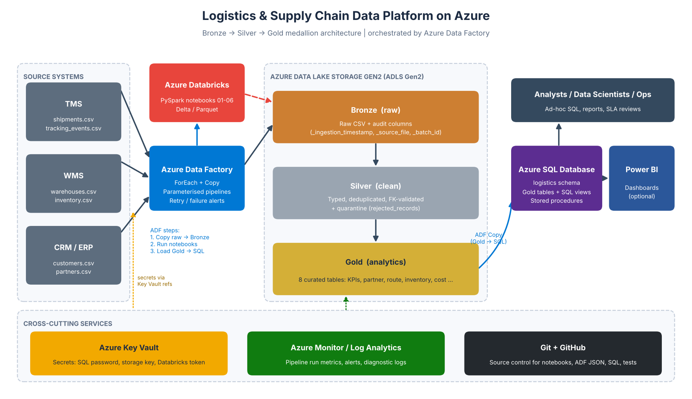

# Architecture

Additional diagrams: `adf_orchestration_flow.png` (pipeline orchestration) and `databricks_transformation_flow.png` (notebook flow). All three are generated by `python -m src.visualization.architecture_diagram`.

## Layers (medallion)
| Layer | Location (Azure) | Local equivalent | Content |
|---|---|---|---|
| Landing | ADLS `landing/<SYSTEM>/file.csv` | `data/raw/` | files dropped by source systems |
| Bronze | ADLS `bronze/raw_files/...` and `bronze/tables/` | `data/bronze/` | raw files preserved byte-for-byte + Parquet tables with audit columns |
| Silver | ADLS `silver/tables/` | `data/processed/` | typed, de-duplicated, validated, enriched; plus `rejected_records` quarantine |
| Gold | ADLS `gold/` | `data/gold/` | 8 analytics tables |
| Serving | Azure SQL Database, schema `logistics` | SQL scripts only | dimensions, facts, Gold tables, stored procedures |

## Components and responsibilities
| Service | Role in this project |
|---|---|
| **Azure Data Factory** | orchestration: metadata-driven ingestion (Lookup + ForEach + Copy), runs Databricks notebooks in order, loads Azure SQL, retry, failure alerts, logging to SQL |
| **ADLS Gen2** | storage for all layers (hierarchical namespace, containers per layer) |
| **Azure Databricks** | PySpark transformations (notebooks 01-06) |
| **Azure SQL Database** | serving layer for analysts / BI: star-schema tables, 24 analytic queries, stored procedures |
| **Azure Key Vault** | secrets (SQL password, Databricks token) referenced by ADF linked services; ADF -> storage uses managed identity |
| **Azure Monitor / Log Analytics** | pipeline run metrics, activity failures, alert rules (see `docs/azure_setup_guide.md`) |
| **Git / GitHub** | source control for notebooks, ADF JSON, SQL, tests |

## Data flow
1. A trigger starts `PL_Master_Logistics` (daily 02:00 UTC) with `run_date`.
2. `SP_Log_Pipeline_Start` writes a row to `logistics.pipeline_run_log`.
3. `PL_Ingest_Raw_To_Bronze` reads `config/source_config.json` (Lookup), loops over tables (ForEach, 4 in parallel) and copies each file from `landing/<system>/` to `bronze/raw_files/<table>/ingest_date=<run_date>/`.
4. `PL_Run_Databricks_Transformations` runs notebooks 01 -> 02 -> (03 || 04) -> 05 -> 06.
5. `PL_Load_Gold_To_SQL` clears SQL tables child-first (stored procedure), loads dimensions, facts and the 8 Gold tables.
6. Success -> `SP_Log_Pipeline_Success`. Any stage failure -> webhook alert + failure log row + `Fail` activity.

## Design decisions
* **Raw is immutable.** ADF copies bytes; Databricks adds audit columns; nothing is overwritten by cleaning.
* **Nothing silently disappears.** Every rejected row is stored with a reason; `bronze = silver + rejected` is asserted.
* **Status derived from dates.** Source labels are not trusted.
* **Parquet (not Delta) for portability.** ADF Copy reads Parquet folders directly. Delta is a drop-in improvement (see README "Future improvements").
* **Truncate-and-load serving layer** is simple and idempotent for this data volume; incremental `MERGE` is listed as a future improvement.
* **Local alternative.** Everything except the Azure services themselves runs locally via `python -m src.run_pipeline` using a pandas reference implementation of the notebook logic.
